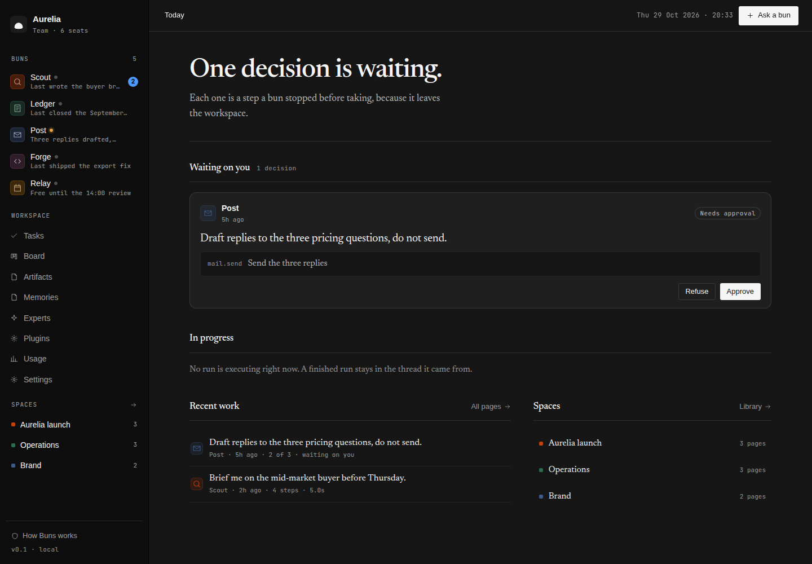
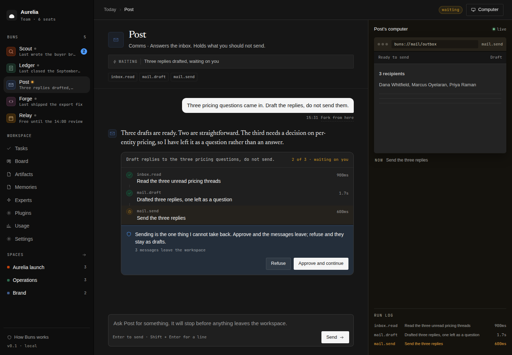

# Buns

A small, stateful AI-coworker workspace written in the **Bun language**. Buns studies [OpenDots](https://github.com/CopilotKit/OpenDots) for its task-and-approval core, then takes its second surface from two more sources: the **board, artifacts, and dark interface language** of [Rakazo](https://github.com/elie222/rakazo), and the **expert library, personas, and plugin contract** of [TencentCloud's Octop](https://github.com/TencentCloud/Octop).

The entire application is `.bun`, HTML, CSS, and vanilla JavaScript. There is **no framework, bundler, package install, database, or JavaScript runtime** in the server.



## What works

- **Today** collects decisions, active tasks, recent work, and spaces in one place.
- **Five buns** have persistent threads, different planning defaults, and the OpenDots `chat / tasks / memories / space` navigation.
- **Tasks** is the full ledger: waiting on you, in progress, scheduled, recently finished, plus a whole-workspace activity feed.
- **Schedules** repeat a goal daily, on weekdays, or weekly; a due schedule starts a real task on read, gates included.
- **Memories** keep one sentence per bun. A finished task writes one automatically, a plan recalls up to three visibly, and the page has full CRUD.
- **Five playbooks** cover research, finance, communications, engineering, and operations.
- **Visible execution** reveals each task step, its tool, duration, and generated computer screen.
- **Real approval gates** stop risky steps. Approving applies the effect; refusing records a skip. A finished task cannot be decided twice.
- **Settings** holds workspace preferences and an honest list of what is not connected.
- **Spaces and pages** include search, grid/list views, nested pages, Markdown rendering, page creation, and revision-checked autosave.
- **Board** — tickets anyone opens, a bun claims, and the engine settles: a claim starts a real task in a real thread, and finishing the task moves the card.
- **Artifacts** — every approved effect leaves a readable copy: the mail that went out, the pull request, the sheet change.
- **Experts** — an Octop-style library of eight experts with MBTI-style personas; hatching one adds a real bun to the rail with its own thread and memory.
- **Plugins** — the tool/skill/hook contract from Octop, kept to its bundled tools: weather, unit conversion, and trending, each running as a visible step.
- **Approval rules** — a rule can pre-approve non-mail gates; mail always asks. Auto-approvals are logged like human decisions.
- **Usage** — tasks, steps, tool distribution, and gate outcomes per bun, counted from the run log.
- **Thread fork** — branch a conversation at any message and continue the copy.
- **Unread counts** on the rail, and a command bar (`Ctrl/Cmd + K`) that reaches every page.
- **Rakazo-aligned dark UI** — near-black sidebar and cards, one status blue, a 12px radius, with Buns' serif narrative voice kept.
- **Responsive UI** works at desktop and phone widths. The computer becomes a drawer on smaller screens.
- **Persistent state** lives in one JSON document behind a mutex, migrated forward when new collections ship.



## Run it

### 1. Get the Bun-language runtime

Clone [Iotatg/Bun](https://github.com/Iotatg/Bun) next to this repository, or use any checkout and set `BUN_LANG_HOME` to the directory containing the `bun` Python package and `lib/bun` standard library.

```sh
git clone https://github.com/Iotatg/Bun.git ../Bun
cd buns
./bin/buns app.bun
```

For an existing checkout:

```sh
BUN_LANG_HOME=/path/to/Bun/bun ./bin/buns app.bun
```

Open `http://127.0.0.1:8801`. The first start seeds the Aurelia demonstration workspace.

### Configuration

| Variable | Default | Purpose |
| --- | --- | --- |
| `PORT` | `8801` | HTTP listen port |
| `BUNS_STATE` | `data/state.json` | Workspace JSON file |
| `BUN_LANG_HOME` | `vendor/` | Bun-language runtime location |

Delete the state file and restart to restore the seed. Do not expose this build directly to untrusted users: it has no authentication.

## Try the core loop

1. Open **Post** from the Buns rail.
2. Inspect the three-step task and the computer panel.
3. Choose **Refuse** or **Approve and continue** on the `mail.send` gate.
4. Ask Scout: `Brief me on freight costs` and watch a new task play — its first step is the memory it recalled.
5. Open **Tasks** and schedule `Review the pipeline` daily for Ledger; it fires on its own from then on.
6. Open **Board**, open a ticket, and hand it to a bun — the claim becomes a task, and the card moves when the task ends.
7. Open **Experts** and hatch Vega; the new bun appears on the rail with its own thread.
8. Ask Relay: `Check the weather in Mumbai` — a bundled plugin runs as a visible step.
9. Open **Spaces**, create a page, and edit it. Saves carry a revision; stale writes return `409` instead of overwriting another edit.
10. Press `Ctrl/Cmd + K` and type a place.

## Verify

```sh
./bin/buns check app.bun
sh scripts/smoke.sh
```

The smoke suite starts an isolated server on port `8802` with a temporary state file. It covers routing, assets, errors, message/task creation, decision replay protection, tasks, schedules, memories, settings, page creation, revision conflicts, and saving, plus the board, artifacts, experts, plugins, usage, approval rules, thread fork, and unread handling: **96 assertions**.

`scripts/test_engine.bun` exercises the planner and run engine directly.

## Routes

| Route | Purpose |
| --- | --- |
| `/` | Today, open gates, active and recent work |
| `/buns/:id` | One bun: thread, tasks, approval gates, computer (`/dots/:id` kept working) |
| `/tasks` | Task ledger, schedules, activity feed |
| `/memories` | What each bun keeps, with add, edit, and delete |
| `/board` | Ticket board: to do, in progress, done |
| `/artifacts`, `/artifacts/:id` | Audit copies of approved effects |
| `/experts` | Expert library and bun hatching |
| `/plugins` | The bundled tool plugins and their contract |
| `/usage` | Tasks, steps, tools, and gates per bun |
| `/settings` | Workspace, notifications, approval rules, integrations status |
| `/spaces` | Space and page library |
| `/spaces/:id` | One space and its documents |
| `/spaces/:id/p/:page` | Markdown page and editor |
| `/search?q=…` | Workspace search |
| `/about` | Exact capabilities and limitations |
| `/health` | JSON health check |

API, aligned with the OpenDots surface:

| Endpoint | Purpose |
| --- | --- |
| `GET /api/state` | The whole workspace document |
| `POST /api/tasks` | Start a task now, or attach a schedule |
| `GET /api/tasks/:id` | One task with its steps and screens |
| `POST /api/tasks/:id/actions` | `approve`, `refuse`, or `respond` |
| `PUT /api/tasks/:id/schedule` | Make a task repeat |
| `DELETE /api/schedules/:id` | Remove a schedule |
| `POST /api/memories`, `PUT/DELETE /api/memories/:id` | Memory CRUD |
| `PATCH /api/settings` | Merge workspace and notification settings |
| `POST /api/messages` | Chat-shaped task start (kept from the first build) |
| `POST /api/runs/:id/decide` | Legacy alias for approve/refuse |
| `POST /api/pages`, `PATCH /api/pages/:id` | Page create and revision-checked save |
| `POST /api/tickets`, `POST /api/tickets/:id/claim`, `POST /api/tickets/:id/move` | Board tickets |
| `POST /api/experts/:id/hatch` | Spawn a bun from the expert library |
| `POST /api/threads/:id/fork` | Fork a thread at a message |

## Source map

```text
app.bun             router, JSON API, static assets
src/http.bun        raw-socket HTTP/1.1, keep-alive, chunked responses
src/store.bun       state, clock, ids, migration, escaping, text helpers
src/seed.bun        Aurelia workspace, memories, schedules, realistic sources
src/agent.bun       planner, five playbooks, plugins, rules, gates, effects, recall step
src/memory.bun      memory CRUD and word-overlap recall
src/schedule.bun    cadence maths, schedule CRUD, fire-on-read
src/work.bun        artifacts and the ticket board
src/experts.bun     expert catalog, MBTI personas, bun hatching
src/plugins.bun     the tool plugin contract and bundled tools
src/panels.bun      Tasks, Board, Artifacts, Experts, Plugins, Usage, Memories, Settings
src/ui.bun          shell, rail, icons, Markdown renderer, shared components
src/views.bun       Today, thread, spaces, pages, generated computer screens
assets/app.css      visual system and responsive layout
assets/app.js       playback, decisions, composer, library, autosave, command bar
scripts/smoke.sh    isolated end-to-end assertions
docs/               desktop and mobile screenshots
```

## Honest boundaries

This is a working product study, not a connected production agent:

- The planner is deterministic; **no LLM call is made**.
- Computer screens are generated from actual workspace state; **no real browser is automated**.
- Mail, pull requests, and calendar effects update local JSON; **no external service is contacted**.
- Scheduled tasks fire when a page is read, not from a background daemon.
- Plugin tools run on deterministic sample data, labelled as such on their screens.
- Hatched buns use the same deterministic planner; the persona shapes defaults, not a model.
- Integrations in Settings are labelled **Not connected** because they are.
- There is one local workspace and no authentication.
- A crash during the single JSON write can damage state; keep backups if the data matters.

OpenDots areas still not modelled here: voice, real computer control and takeover, and live integrations. They are named as absent rather than stubbed.

## Research and design

See [DESIGN.md](DESIGN.md) for the design reasoning, the alignment tables, and what each source contributed and what was cut.

## License

MIT for this project. OpenDots and impeccable remain under their respective licenses; no OpenDots application code is copied into Buns.
